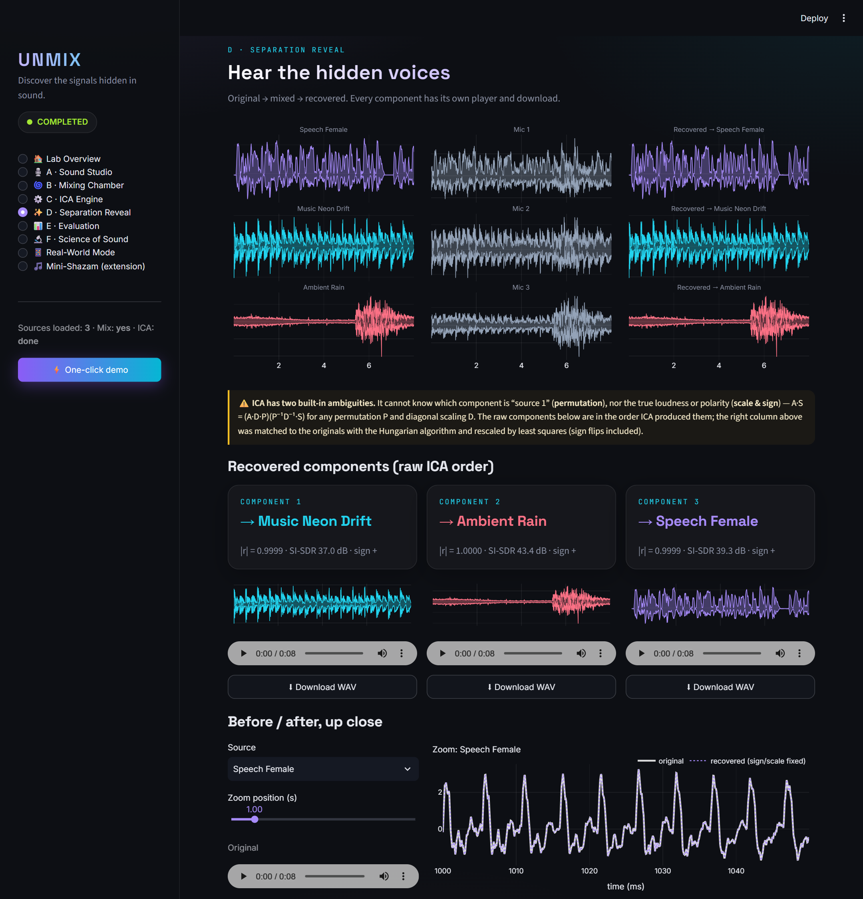
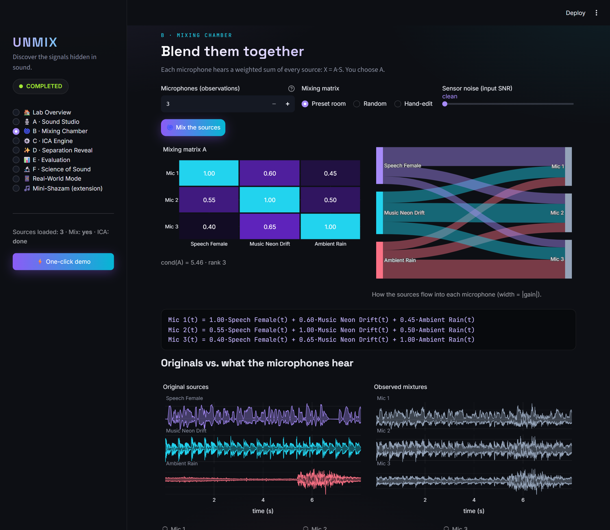
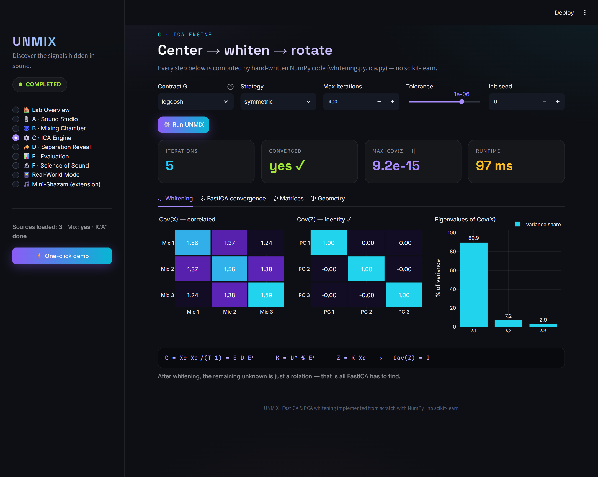
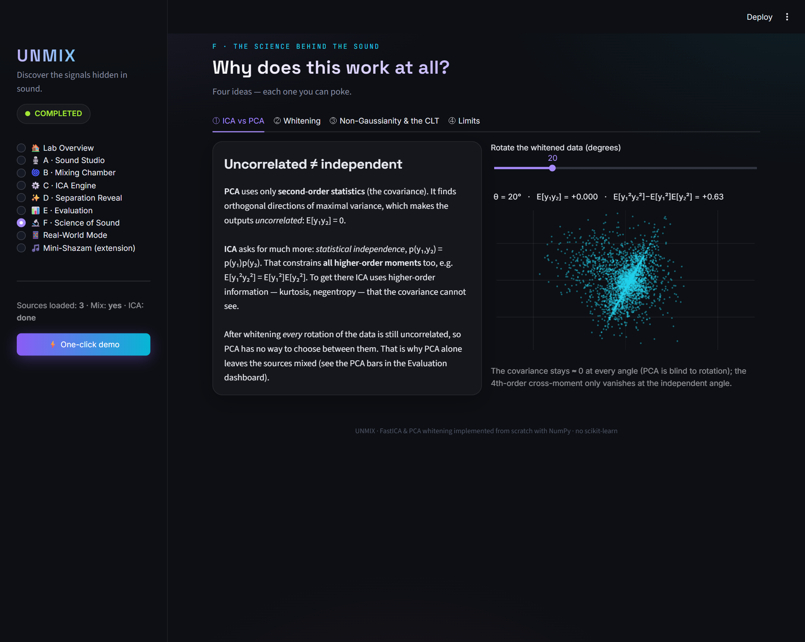
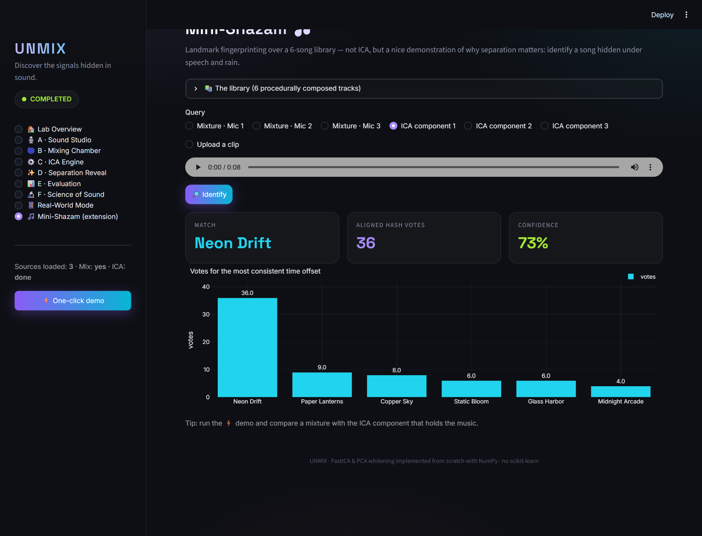
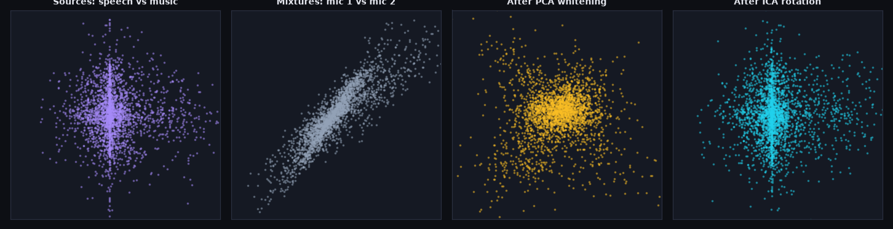
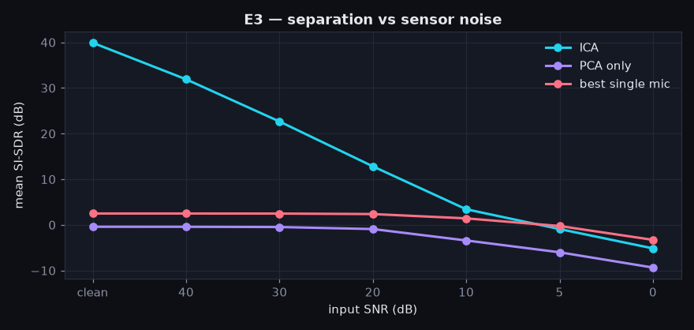

# UNMIX — The AI Audio Separation Lab

> **Discover the signals hidden in sound.**
> One recording. Multiple hidden voices. One algorithm to separate them.

UNMIX mixes clean speech, music and ambient sound with a mixing matrix you control, then recovers every
source with **PCA whitening and FastICA, both implemented from scratch in NumPy** (no scikit-learn, no
library ICA). It plays and exports the separated audio and scores it against the originals with
permutation-, sign- and scale-invariant metrics.



| Headline result (E1: speech + music + rain, custom 3×3 matrix, no noise) | ICA | PCA only | best single mic |
|---|---|---|---|
| mean SI-SDR | **39.9 dB** | −0.4 dB | 2.5 dB |
| mean \|correlation\| with the matched source | **0.9999** | — | — |
| Amari index (0 = perfect) | **0.0066** | — | — |

All numbers are produced by `python experiments.py` and written to [REPORT.md](REPORT.md). Nothing is typed in by hand.

---

## Contents
> 📘 **New to ICA?** Read the illustrated beginner's guide: [docs/UNMIX_Beginners_Guide.pdf](docs/UNMIX_Beginners_Guide.pdf)

1. [Quick start](#1-quick-start)
2. [Live demo script (hackathon)](#2-live-demo-script-hackathon)
3. [Project structure](#3-project-structure)
4. [Audio sources](#4-audio-sources)
5. [The pipeline and the maths](#5-the-pipeline-and-the-maths)
6. [Be ready to explain](#6-be-ready-to-explain)
7. [Evaluation: metrics and why they were chosen](#7-evaluation-metrics-and-why-they-were-chosen)
8. [Experiments and results](#8-experiments-and-results)
9. [Separated audio files](#9-separated-audio-files)
10. [Optional extensions](#10-optional-extensions)
11. [Tests](#11-tests)
12. [Limitations, assumptions and future work](#12-limitations-assumptions-and-future-work)

---

## 1. Quick start

```bash
python -m venv .venv
.venv\Scripts\activate          # Windows   |   source .venv/bin/activate  (macOS/Linux)
pip install -r requirements.txt

streamlit run app.py             # the lab UI, http://localhost:8501
python experiments.py            # reproduce every number, figure and WAV in REPORT.md (~40 s)
python -m pytest -q              # 30 unit tests for the maths
```

Optional extras:

```bash
python generate_sources.py               # re-create the bundled audio from scratch
python notebooks/build_notebook.py       # re-execute the walkthrough notebook
```

Developed and tested with Python 3.14, NumPy 2.5, SciPy 1.18 and Streamlit 1.65. Any recent Python 3.10+ should work.

## 2. Live demo script (hackathon)

| Time | Do | Say |
|---|---|---|
| 0:00 | Open `http://localhost:8501/?page=home` | "Three microphones, three sounds, every mic hears everything." |
| 0:20 | Click **⚡ One-click demo**, which lands on **Separation Reveal** | "Left: the originals. Middle: what the mics heard. Right: what ICA recovered." Play Mic 1, then component 3. |
| 1:00 | Point at the amber note | "ICA can't know the order or polarity, so we match with the Hungarian algorithm." |
| 1:20 | **ICA Engine**, then **④ Geometry** tab | "Mixing shears the '+'; whitening makes it round; ICA finds the rotation." |
| 2:00 | **Science**, then **③**: drag the rotation slider to the peak | "ICA = find the most non-Gaussian rotation. The CLT says mixtures are more Gaussian." |
| 2:40 | **Evaluation**, then **Run noise sweep** | "40 dB clean; PCA alone ≈ 0 dB. With noise, quality tracks input SNR: ICA separates, it doesn't denoise." |
| 3:20 | **Mini-Shazam**, then Mixture vs ICA component | "Song hidden under speech is hard to identify; after ICA it's recognised." |

Deep links are handy on stage: `?page=reveal&demo=1` opens the Reveal with the demo already computed
(pages: `home studio mixing engine reveal eval science real shazam`).

<details><summary>More screenshots</summary>

| | |
|---|---|
|  |  |
|  |  |
|  |  |
|  | |

</details>

## 3. Project structure

```
app.py               Streamlit interface: Studio, Mixing Chamber, ICA Engine, Reveal, Evaluation, Science, Real-World, Mini-Shazam
whitening.py         centering, covariance, eigendecomposition, PCA whitening (from scratch)
ica.py               FastICA (logcosh / exp / cube; symmetric & deflation), negentropy, kurtosis (from scratch)
audio_utils.py       WAV loading, int→float, stereo→mono, polyphase resampling, length alignment, mixing, noise, export
evaluation.py        Hungarian matching, SI-SDR, SIR/SAR, Amari index, |correlation|
visualization.py     Plotly (interactive) and Matplotlib (report) figures, one neon-on-charcoal palette
experiments.py       8 reproducible experiments → outputs/results.json, outputs/figures, outputs/separated, REPORT.md
fingerprint.py       optional extension: landmark audio fingerprinting ("mini-Shazam")
generate_sources.py  builds every bundled audio file (TTS speech, procedural music/rain/birds, song library)
data/sources/        clean sources for ICA
data/library/        6 songs for the fingerprinting extension
data/raw/            raw text-to-speech renders
outputs/             separated WAVs, figures, results.json
notebooks/           unmix_walkthrough.ipynb (executed, with outputs and audio players) + its builder
tests/               pytest suite
docs/screenshots/    UI screenshots
```

## 4. Audio sources

All audio is **generated locally**, so there is nothing to download and no licensing question. The
bundled files are deliberately stored at **different sample rates and channel counts**, so the loader's
resampling and mono conversion are really exercised.

| File | Type | Format | How it was made |
|---|---|---|---|
| [speech_female.wav](data/sources/speech_female.wav) | speech | 22.05 kHz mono | Windows SAPI text-to-speech, voice *Microsoft Zira* ([raw](data/raw/speech_female_raw.wav)) |
| [speech_male.wav](data/sources/speech_male.wav) | speech | 22.05 kHz mono | Windows SAPI text-to-speech, voice *Microsoft David* ([raw](data/raw/speech_male_raw.wav)) |
| [music_neon_drift.wav](data/sources/music_neon_drift.wav) | music | 44.1 kHz stereo | procedural synth-pop: Karplus–Strong plucks, sine bass, synthesized kick & hats |
| [ambient_rain.wav](data/sources/ambient_rain.wav) | ambient | 48 kHz stereo | band-passed noise with wind swells, Poisson rain-drops (heavy-tailed), thunder roll |
| [ambient_birds.wav](data/sources/ambient_birds.wav) | ambient | 16 kHz mono | FM-swept bird chirps |

Fingerprinting library (16 kHz mono, 16 s each): [01 Neon Drift](data/library/01_neon_drift.wav) ·
[02 Copper Sky](data/library/02_copper_sky.wav) · [03 Midnight Arcade](data/library/03_midnight_arcade.wav) ·
[04 Paper Lanterns](data/library/04_paper_lanterns.wav) · [05 Static Bloom](data/library/05_static_bloom.wav) ·
[06 Glass Harbor](data/library/06_glass_harbor.wav). "Neon Drift" is the same composition as the music source.

You can also upload any WAV files in the Sound Studio (any rate, mono or stereo).

## 5. The pipeline and the maths

**Model.** n independent sources S (n × T) are mixed instantaneously by an unknown matrix A (m × n, m ≥ n):

```
X = A S        each microphone row = weighted sum of all sources
```

| Step | Code | What happens |
|---|---|---|
| 1. Load | `audio_utils.load_audio` | WAV → float in [-1, 1] → mono → `resample_poly` to 16 kHz; silent/corrupt files raise a clear error |
| 2. Align | `align_lengths`, `standardize` | trim to common length, zero mean / unit variance |
| 3. Mix | `mix`, `add_noise` | X = A S (+ optional white sensor noise at a target SNR) |
| 4. Center | `whitening.center` | Xc = X − mean(X) |
| 5. Covariance | `whitening.covariance` | C = Xc Xcᵀ / (T − 1) |
| 6. Eigendecomposition | `np.linalg.eigh(C)` | C = E D Eᵀ (sorted descending) |
| 7. Whitening | `whitening.pca_whiten` | K = D^-½ Eᵀ, Z = K Xc ⇒ Cov(Z) = I. Keeps the top-n components when m > n; rejects rank-deficient requests |
| 8. FastICA | `ica.fastica` | fixed-point iteration below, until directions stop changing (tol 1e-6) |
| 9. Unmix | `ica.run_ica` | Ŝ = W K Xc; estimated mixing = K⁻¹ Wᵀ |
| 10. Export | `audio_utils.save_wav` / `wav_bytes` | peak-normalised 16-bit PCM; silent signals become zeros, never NaN |
| 11. Evaluate | `evaluation.evaluate` | Hungarian matching + SI-SDR, SIR, SAR, \|r\|, Amari |

**FastICA update** (Hyvärinen & Oja). For each row w of W, with g = G′:

```
w ← E[ z · g(wᵀz) ] − E[ g′(wᵀz) ] · w           (approximate Newton step on negentropy)
W ← (W Wᵀ)^-½ W                                  (symmetric decorrelation keeps W orthogonal)
```

| Contrast | G(u) | g(u) | Use |
|---|---|---|---|
| `logcosh` (default) | log cosh u | tanh u | robust general-purpose |
| `exp` | −exp(−u²/2) | u·exp(−u²/2) | very super-Gaussian sources, robust to outliers |
| `cube` | u⁴/4 | u³ | kurtosis-based; fast but outlier-sensitive |

A deflation variant (one component at a time, with Gram–Schmidt) is also included and compared in E4.

## 6. Be ready to explain

**1. Why ICA over PCA?**
PCA uses only **second-order statistics** (the covariance). It returns orthogonal directions of maximal
variance, which makes the outputs **uncorrelated**: E[y₁y₂] = 0. Uncorrelated is much weaker than
**independent**, p(y₁, y₂) = p(y₁)p(y₂), which constrains all higher-order moments too, e.g. E[y₁²y₂²] = E[y₁²]E[y₂²].
After whitening, *every* rotation of the data is still uncorrelated, so second-order statistics cannot
pick the right one. ICA uses **higher-order statistics** (non-Gaussianity, measured through negentropy or
kurtosis) to choose it. Evidence: PCA-only scores −0.4 dB SI-SDR in E1 vs 39.9 dB for ICA. In the app,
Science, then ①, shows E[y₁y₂] staying ≈ 0 at every angle while the 4th-order cross-moment changes.

**2. What whitening does and why it simplifies ICA.**
Whitening (K = D^-½ Eᵀ) rotates the centred data onto its principal axes and rescales each axis to unit
variance, so Cov(Z) = I (we verify max |Cov(Z) − I| ≈ 1e-14). Because the sources can be taken to have
unit variance (scale is unidentifiable anyway), Cov(Z) = (KA)(KA)ᵀ = I. That means **KA is orthogonal**:
the unknown n×n matrix (n² parameters) becomes an unknown **rotation** (n(n−1)/2 parameters, a single
angle for two sources). The FastICA update plus symmetric decorrelation only searches over rotations,
and the Newton-style iteration converges in a handful of steps (4–8 here). With extra microphones,
whitening also performs PCA dimension reduction to n components and discards noise-only directions (E2).

**3. Why non-Gaussianity enables separation; the Central Limit Theorem.**
The CLT says a sum of independent random variables tends to be *more Gaussian* than the individual
terms (under mild conditions). Every microphone signal yᵀ = wᵀx is such a sum, so it is generally more
Gaussian than the sources. Non-Gaussianity is therefore **maximised when w picks out exactly one
source**, and ICA searches for exactly those directions. Measured (E7): excess kurtosis drops from 8.9 for a
single source to 2.0 for a sum of five. The flip side: a rotation of Gaussian variables is still Gaussian,
so with **two or more Gaussian sources** there is nothing to lock onto. E6 shows two Gaussian sources
collapsing to ≈ 2 dB while the speech next to them is still recovered at 60 dB.

**4. How experiments and metrics were chosen.**
Each experiment isolates one assumption of the ICA model: the **mixing matrix** (E2: random, ill-conditioned,
overdetermined), **sensor noise** (E3: an SNR sweep), **algorithm choices** (E4: contrast and strategy),
**scale** (E5: 2 to 5 sources), **identifiability** (E6: Gaussian sources) and the **CLT premise** (E7).
Metrics must be invariant to ICA's permutation, sign and scale ambiguity, so components are matched with
the **Hungarian algorithm** on |correlation| and every score is scale-invariant (see §7). Every ICA
result is shown next to two baselines, the **best single microphone** (no processing) and
**PCA only** (second-order statistics), so the numbers mean something.

## 7. Evaluation: metrics and why they were chosen

ICA returns components in an arbitrary **order**, with arbitrary **sign and scale**
(A S = (A P⁻¹D⁻¹)(D P S) for any permutation P and diagonal D). So evaluation:

1. builds the |Pearson correlation| matrix between every source and every component;
2. solves the **linear assignment problem** (Hungarian algorithm, `scipy.optimize.linear_sum_assignment`)
   to maximise the total |r|. A greedy match can assign two sources to one component; this cannot;
3. computes only **scale- and sign-invariant** metrics:

| Metric | Definition | Why |
|---|---|---|
| \|r\| | absolute Pearson correlation | intuitive; but saturates (0.99 ≈ 17 dB) |
| **SI-SDR** | ŷ = αs + e, α = ⟨ŷ,s⟩/‖s‖²; 10·log10(‖αs‖²/‖e‖²) | standard in source separation; the optimal gain is solved, so sign/scale don't matter |
| SIR / SAR | error split into leakage from other sources vs. noise/artefacts (BSS-Eval with 0-tap gains, appropriate for instantaneous mixing) | tells *why* a separation is imperfect. SAR is undefined (∞) when there is no noise |
| Amari index | normalised distance of (W K) A from a scaled permutation | judges the *unmixing matrix* itself, independent of the signals (needs the true A) |
| Best-mic SI-SDR | SI-SDR of the best raw microphone | the "do nothing" baseline; improvement = ICA − this |

**Limitations of the metrics:** they all need ground truth (clean sources or A), so they are unavailable
for real recordings, where UNMIX reports independence proxies (kurtosis, negentropy) instead. SI-SDR is an
energy ratio, not a perceptual score.

## 8. Experiments and results

Full tables and figures: **[REPORT.md](REPORT.md)**. Raw numbers: [outputs/results.json](outputs/results.json).
Settings: 8 s at 16 kHz, log-cosh, symmetric, tol 1e-6, fixed seeds.

| Experiment | Key finding (measured) |
|---|---|
| E1 baseline (speech, music, rain; custom A, cond 5.5) | ICA **39.9 dB** mean SI-SDR (37.0–43.4 per source), \|r\| ≥ 0.9999, Amari 0.0066, 5 iterations. PCA −0.4 dB; best mic 2.5 dB |
| E2 mixing matrices (30 random A) | Noise-free: **39.9 dB for every A** (FastICA is *equivariant*; after whitening the result doesn't depend on A). At 30 dB SNR: median 26.2 dB, corr(log cond A, SI-SDR) = **−0.97**. Ill-conditioned A (cond 24 054) + 30 dB noise **fails** (−15 dB). 5 mics beat 3 mics at 20 dB SNR (16.3 vs 13.8 dB) |
| E3 noise sweep | clean 39.9 → 40 dB SNR 31.9 → 30 dB 22.7 → 20 dB 12.8 → 10 dB 3.4 → 0 dB −5.2 dB. ICA output tracks input SNR: separation ≠ denoising |
| E4 contrasts (4 sources, 30 dB) | logcosh / exp / cube all ≈ 21.5–21.6 dB; symmetric needs 5–6 iterations vs 11–15 for deflation |
| E5 2–5 sources (30 dB) | 17.7, 25.6, 20.8, 20.3 dB; PCA ≤ 1.4 dB throughout |
| E6 Gaussian sources | 0 or 1 Gaussian source: all recovered (≥ 37 dB). **2 Gaussians: those two fail (≈ 2.3 dB)**, the speech still 60 dB |
| E7 CLT | mean excess kurtosis 8.9 (1 source) → 5.1 → 3.2 → 2.5 → 2.0 (5 summed) |
| E8 mini-Shazam | music mixed quietly: the raw mics get only 2–3 votes and two of the three pick the wrong song; the ICA music component is identified ("Neon Drift", 36 votes vs 9 for the runner-up) |




The walkthrough notebook **[notebooks/unmix_walkthrough.ipynb](notebooks/unmix_walkthrough.ipynb)**
repeats the pipeline cell by cell (with plots, tables and embedded audio players).

## 9. Separated audio files

Produced by `python experiments.py` (16 kHz, 16-bit PCM, peak-normalised):

**E1 baseline:** [outputs/separated/e1_baseline/](outputs/separated/e1_baseline/)
- mixtures: [mic 1](outputs/separated/e1_baseline/mixture_mic1.wav) · [mic 2](outputs/separated/e1_baseline/mixture_mic2.wav) · [mic 3](outputs/separated/e1_baseline/mixture_mic3.wav)
- recovered (matched, sign/scale fixed): [speech](outputs/separated/e1_baseline/recovered_speech_female.wav) · [music](outputs/separated/e1_baseline/recovered_music.wav) · [rain](outputs/separated/e1_baseline/recovered_rain.wav)
- raw ICA components (arbitrary order/sign): [IC 1](outputs/separated/e1_baseline/ica_component_1.wav) · [IC 2](outputs/separated/e1_baseline/ica_component_2.wav) · [IC 3](outputs/separated/e1_baseline/ica_component_3.wav)
- PCA-only components for comparison: [PC 1](outputs/separated/e1_baseline/pca_component_1.wav) · [PC 2](outputs/separated/e1_baseline/pca_component_2.wav) · [PC 3](outputs/separated/e1_baseline/pca_component_3.wav)

**E5 cocktail party (2 speakers + music + rain, 30 dB SNR):** [outputs/separated/e5_cocktail_party_4src/](outputs/separated/e5_cocktail_party_4src/)

Every run in the app can also be downloaded per component, or as a ZIP with originals, mixtures, raw and aligned components, `report.md` and `metrics.json`.

## 10. Optional extensions

All of these are implemented:
- **PCA vs ICA** side by side (Evaluation dashboard + every experiment).
- **Interactive mixing-matrix editor**, random/preset matrices, condition-number and rank warnings, Sankey "who reaches which mic" diagram.
- **Separation-quality meter**: a gauge driven by the real mean SI-SDR, with plain-language bands.
- **Noise / mixing-condition experiments live** on your own sources.
- **Real-world mode**: upload 2–6 simultaneous recordings from different devices; start offsets are aligned by FFT cross-correlation; ICA runs without ground truth (kurtosis/negentropy proxies shown). See limitations below.
- **Mini-Shazam** (`fingerprint.py`, clearly marked as *not* ICA): spectrogram peak constellations → (f₁, f₂, Δt) landmark hashes → offset-histogram voting over a 6-song library.
- **Downloadable report**: Markdown + JSON + ZIP of all audio per run.

## 11. Tests

`python -m pytest -q` runs **30 tests**:
- whitening gives identity covariance (incl. overdetermined 6-mic case); rank-deficient and silent inputs are rejected;
- FastICA recovers known synthetic sources (sine, square, Laplacian, uniform) for **all 3 contrasts × 2 strategies** with |r| > 0.99 and Amari < 0.02; W is orthogonal; (W K) A is a scaled permutation; estimated mixing reconstructs X; seeded runs are deterministic;
- PCA alone does *not* separate;
- matching recovers arbitrary permutation + sign + scale; SI-SDR is scale/sign invariant; Amari index bounds;
- audio: int16 stereo 44.1 kHz → mono 16 kHz; silent and non-WAV files raise informative errors; trim/pad alignment; safe normalisation of silence; exported WAVs are valid 16-bit PCM; noise hits the requested SNR; cross-correlation recovers a 237-sample device offset;
- end-to-end on the bundled audio (> 25 dB) and fingerprint identification with the correct time offset.

## 12. Limitations, assumptions and future work

**Assumptions of the model:** instantaneous linear mixing X = AS; m ≥ n observations with full-rank A;
statistically independent sources; at most one Gaussian source.

**Limitations:**
- **Synthetic mixing.** Real rooms are *convolutive* (delays and reverberation: each mic hears filtered
  copies). Time-domain instantaneous ICA gives only partial separation there, so the real-world mode is
  an honest experiment, not a promise.
- **Noise is not removed.** It is unmixed with the sources and amplified by ill-conditioned A (E2, E3).
- **Ambiguities** (order, sign, scale) are fundamental; we resolve them only for evaluation, using ground truth.
- **Short clips** (8 s): finite-sample dependence between sources caps the noise-free SI-SDR at ~40 dB.
- **Synthetic speech/music.** TTS voices and procedural music are cleaner than real recordings.
- Metrics require ground truth; perceptual quality is not measured (no PESQ/STOI).

**Future work:** frequency-domain ICA (STFT + per-bin complex ICA + permutation alignment) for convolutive
real-room mixtures; underdetermined separation (m < n) via sparse component analysis or NMF; online/streaming
ICA; perceptual metrics; GPU batch processing; real multi-device recordings with clock-drift correction.

---

*Built for the "Unmix the Signal (ICA)" challenge. Core maths: `whitening.py` + `ica.py`, ≈ 330 lines of commented NumPy.*
