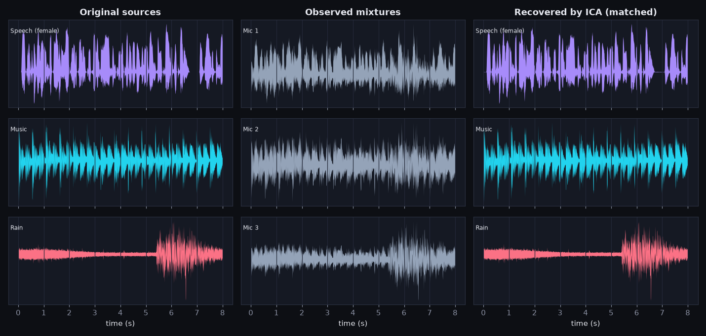
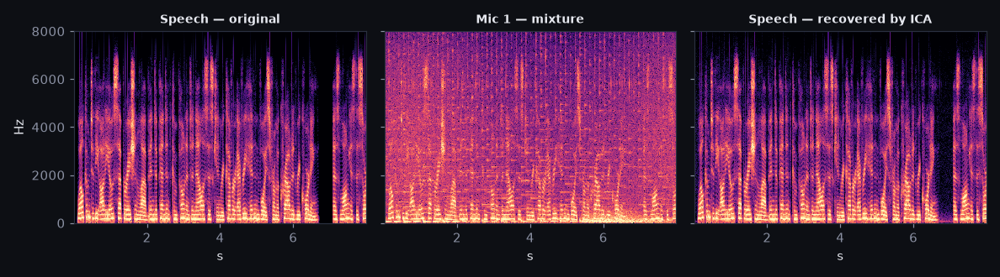
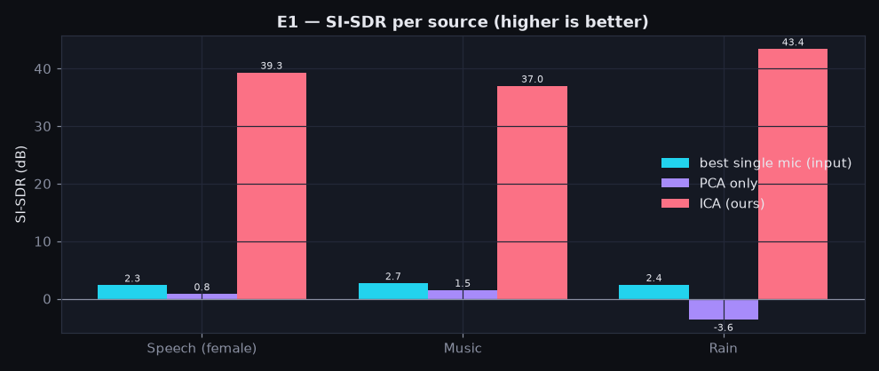
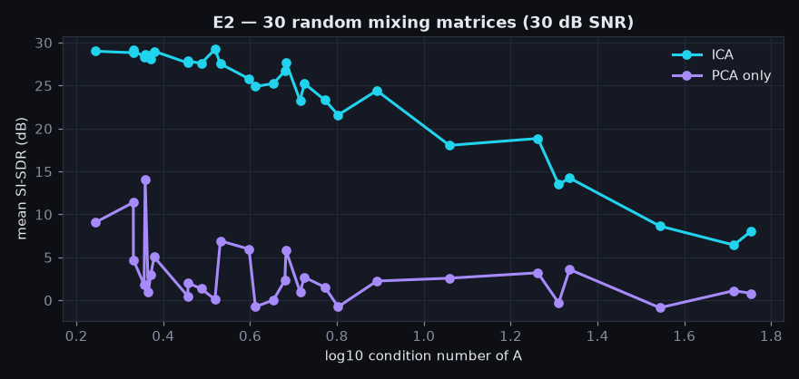
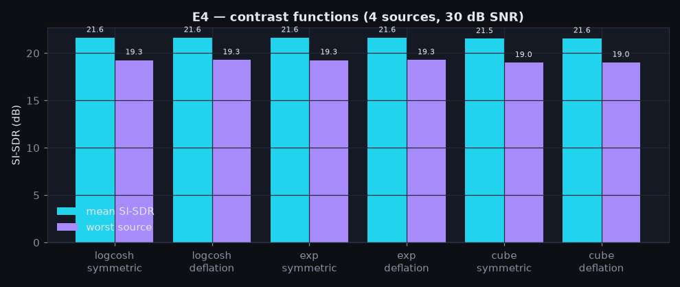
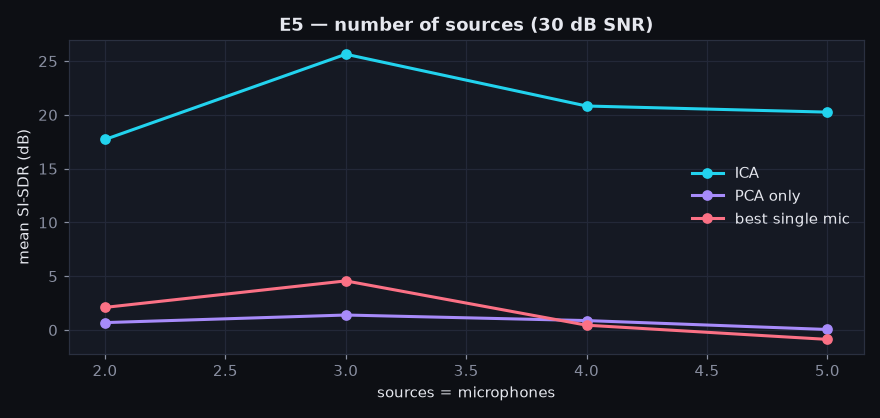
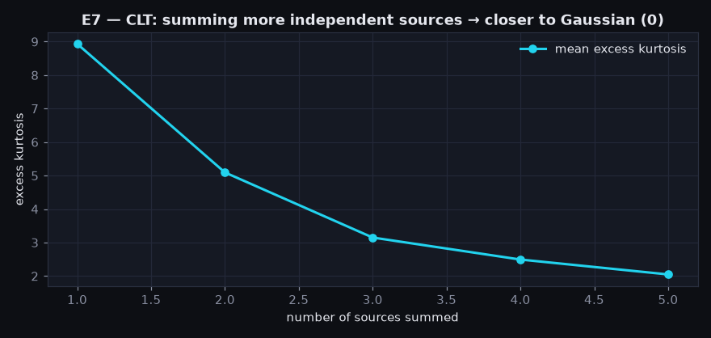

# UNMIX — Experiment Report

_Auto-generated by `python experiments.py` — every number below is computed, not typed. Audio: 8 s at 16000 Hz; sources standardised to unit variance; FastICA (log-cosh, symmetric) on PCA-whitened data; tolerance 1e-6._

**Metrics.** |r| = absolute Pearson correlation of each source with its Hungarian-matched component. SI-SDR = scale-invariant signal-to-distortion ratio (dB, sign/scale-invariant). *Input* = SI-SDR of the best single microphone for that source (what you get without any processing). Amari index = 0 for perfect separation (uses the true A).

## E1 — Baseline: speech + music + rain, custom 3×3 mixing matrix

Mixing matrix A (cond = 5.465):

| | Speech | Music | Rain |
|---|---|---|---|
| Mic 1 | 1.00 | 0.60 | 0.45 |
| Mic 2 | 0.55 | 1.00 | 0.50 |
| Mic 3 | 0.40 | 0.65 | 1.00 |

Whitening check: max |Cov(Z) − I| = 9.21e-15. FastICA converged = True after 5 iterations (0.07 s).

| Source | matched IC | sign | |r| | SI-SDR (dB) | SIR (dB) | input SI-SDR | PCA SI-SDR |
|---|---|---|---|---|---|---|---|
| Speech (female) | 3 | + | 0.9999 | 39.3 | 39.3 | 2.3 | 0.8 |
| Music | 1 | + | 0.9999 | 37.0 | 37.0 | 2.7 | 1.5 |
| Rain | 2 | + | 1.0000 | 43.4 | 43.4 | 2.4 | -3.6 |

Mean SI-SDR: **ICA 39.9 dB** vs PCA -0.4 dB vs input 2.5 dB (improvement 37.4 dB). Amari index 0.0066.

Global matrix W·A (should be a scaled permutation):

```
+0.0057  +1.0002  -0.0129
+0.0025  -0.0063  +1.0001
+1.0001  -0.0019  +0.0107
```




The scatter plots tell the whole story: the sources form a '+' shape (independent, sparse); mixing shears it; whitening makes it round in covariance but still rotated; the ICA rotation aligns the arms with the axes.





## E2 — Different mixing matrices

30 random matrices with entries U(−1, 1).

* **No noise:** ICA SI-SDR is 39.9–39.9 dB for *every* matrix. This is the *equivariance* property of FastICA: after whitening, the separation result does not depend on A at all (the algorithm only sees K·A·S, and K·A is always an orthogonal matrix).
* **30 dB sensor noise:** ICA median **26.2 dB** (min 6.4, max 29.2); 77% of trials above 20 dB; PCA median 2.1 dB. Correlation between log10 cond(A) and SI-SDR: -0.97.

| Condition | cond(A) | ICA SI-SDR | PCA SI-SDR | Amari |
|---|---|---|---|---|
| custom (well-conditioned) | 5 | 39.9 | -0.4 | 0.0070 |
| ill-conditioned, clean | 24054 | 39.9 | 1.1 | 0.0070 |
| ill-conditioned, 30 dB SNR | 24054 | -15.0 | -17.9 | 0.2570 |
| 3 mics, 20 dB SNR | 6 | 13.8 | 2.5 | — |
| 5 mics, 20 dB SNR | 6 | 16.3 | -1.1 | — |

Without noise the condition number barely matters — ICA inverts A exactly in theory. With noise, an ill-conditioned A means the unmixing matrix has huge gains that amplify the noise. Extra microphones (overdetermined case) help because PCA keeps the 3 signal dimensions and discards noise-only ones.



## E3 — Sensor-noise sweep (mean of seeds)

| input SNR (dB) | ICA SI-SDR | PCA SI-SDR | best mic | ICA mean |r| |
|---|---|---|---|---|
| clean | 39.9 | -0.4 | 2.5 | 1.000 |
| 40 | 31.9 | -0.4 | 2.5 | 1.000 |
| 30 | 22.7 | -0.5 | 2.5 | 0.997 |
| 20 | 12.8 | -0.9 | 2.4 | 0.974 |
| 10 | 3.4 | -3.4 | 1.4 | 0.827 |
| 5 | -0.9 | -6.0 | -0.2 | 0.667 |
| 0 | -5.2 | -9.4 | -3.3 | 0.487 |

The noiseless model X = AS is exactly invertible, so the clean result is limited only by finite-sample dependence between the sources. With additive noise, the unmixing matrix also passes noise through: ICA output quality tracks the input SNR — ICA separates *sources*, it does not denoise.


## E4 — Contrast functions & extraction strategy (4 sources, 30 dB SNR)

| contrast | algorithm | mean SI-SDR | worst source | iterations | time (s) |
|---|---|---|---|---|---|
| logcosh | symmetric | 21.6 | 19.3 | 6 | 0.09 |
| logcosh | deflation | 21.6 | 19.3 | 13 | 0.07 |
| exp | symmetric | 21.6 | 19.3 | 6 | 0.09 |
| exp | deflation | 21.6 | 19.3 | 15 | 0.08 |
| cube | symmetric | 21.5 | 19.0 | 5 | 0.11 |
| cube | deflation | 21.6 | 19.0 | 11 | 0.12 |



## E5 — Number of sources (square mixing, 30 dB SNR)

| sources | ICA | PCA | best mic | iterations |
|---|---|---|---|---|
| 2 | 17.7 | 0.7 | 2.1 | 4 |
| 3 | 25.6 | 1.4 | 4.6 | 4 |
| 4 | 20.8 | 0.9 | 0.4 | 7 |
| 5 | 20.3 | 0.0 | -0.9 | 8 |



## E6 — Identifiability: Gaussian sources (clean, custom A)

| case | per-source SI-SDR (dB) | Amari | excess kurtosis of sources |
|---|---|---|---|
| 0 Gaussian (speech, music, rain) | Speech: 39.3, Music: 37.0, Rain: 43.4 | 0.007 | 3.84, 0.87, 9.49 |
| 1 Gaussian (speech, music, noise) | Speech: 52.6, Music: 43.3, Gaussian A: 45.8 | 0.003 | 3.84, 0.87, -0.00 |
| 2 Gaussian (speech, noise, noise) | Speech: 60.2, Gaussian A: 2.3, Gaussian B: 2.4 | 0.256 | 3.84, -0.00, -0.00 |

With one Gaussian source ICA still works (it is identified as 'whatever is left'). With two, any rotation of the two Gaussians is equally Gaussian, so ICA cannot find the original pair: their SI-SDR collapses while the non-Gaussian speech is still recovered.

## E7 — Central Limit Theorem in action

Excess kurtosis of each clean source: Speech (female) 3.84, Music 0.87, Rain 9.49, Speech (male) 14.01, Birds 13.00.

| sources summed | mean excess kurtosis |
|---|---|
| 1 | 8.93 |
| 2 | 5.09 |
| 3 | 3.15 |
| 4 | 2.49 |
| 5 | 2.05 |



## E8 — Optional extension: mini-Shazam before vs after ICA

Library of 6 procedural songs; music mixed quietly under speech and rain.

| signal | top match | votes | runner-up votes | confidence |
|---|---|---|---|---|
| Mic 1 | Copper Sky | 2 | 1 | 0.33 |
| Mic 2 | Neon Drift | 3 | 2 | 0.25 |
| Mic 3 | Midnight Arcade | 3 | 2 | 0.25 |
| ICA component 1 | Neon Drift | 36 | 9 | 0.73 |
| ICA component 2 | Neon Drift | 2 | 1 | 0.33 |
| ICA component 3 | Neon Drift | 1 | 1 | 0.00 |

## Limitations

* Mixtures are synthetic and *instantaneous* (X = AS). Real rooms add delays and reverberation (convolutive mixing), which this model does not capture — see README for the real-world mode caveats.
* Metrics need ground truth; for real recordings only listening and independence proxies are available.
* Sources are short (8 s); finite-sample dependence between them caps the clean SI-SDR.
